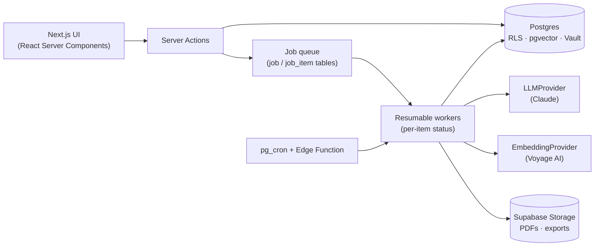

# Cognilit

[](https://github.com/cris33rj/cognilit/actions/workflows/ci.yml)
[](LICENSE)


**An AI-first, human-in-the-loop web app for conducting systematic literature reviews end to end, following PRISMA 2020.**

Cognilit takes a researcher from the review question to an exportable report: protocol, reference import and deduplication, two-stage screening, PDF ingestion, AI-assisted data extraction, semantic search over the corpus, qualitative synthesis, a live PRISMA flow diagram and a structured report draft exported to DOCX, PDF and Markdown.

The guiding rule is that **AI proposes, humans decide**. AI does the repetitive work, but every judgment (screening, synthesis, report writing) is a suggestion that a person accepts, edits or rejects. Every factual AI output must point to the exact passage and page of the source PDF, or explicitly answer "not found".

> **Language note:** Cognilit is built for Brazilian researchers in the social sciences and education, so the UI, the product specs and most code comments are in Brazilian Portuguese. Code identifiers, this README and the architecture notes are in English.

---

## Highlights

- **Grounded AI extraction.** The LLM fills a user-defined extraction form from each PDF. Every value carries `{value, source_span, page}` or `{value: null, reason: "not_found"}`, so nothing is filled in by guesswork.
- **Provenance and audit trail.** Each AI suggestion records model, version, source excerpt, timestamp and state (pending / accepted / edited / rejected). State changes go to an append-only audit log, and the final report states automatically where AI was used.
- **Live PRISMA 2020.** The flow diagram is computed from database views, so its numbers always match the actual records. It renders to SVG/PNG and is embedded in the exported report together with the auto-filled PRISMA checklist.
- **Unified screening workbench.** Import, deduplication (automatic for exact matches, human-confirmed for fuzzy pairs) and title/abstract plus full-text screening happen on one surface with keyboard shortcuts.
- **Semantic search (RAG).** PDF text is chunked with page anchors and embedded into pgvector (HNSW index). Search is scoped to a single review through Row Level Security.
- **Bring your own key.** Users supply their own LLM key (Anthropic Claude by default) and embedding key (Voyage AI). Both are encrypted at rest in Supabase Vault and decrypted only server-side. Cost estimates are shown before batch runs, and token usage is tracked per review and phase.
- **Resilient async jobs.** Heavy work (PDF parsing, batch extraction, embeddings, synthesis, report export) runs as persisted, resumable jobs with per-item failure isolation, never inside a request.
- **Multi-format export.** DOCX, PDF and Markdown reports; references in BibTeX and RIS; citations formatted in APA 7 via citeproc.

## Tech stack

| Area | Choice |
|---|---|
| Frontend | Next.js 14 (App Router, Server Components, Server Actions), React 18, TypeScript (strict), Tailwind CSS 4, TanStack Table / Query / Virtual, React Hook Form + Zod |
| Backend | Supabase: PostgreSQL with Row Level Security on every table, Auth, Storage, Vault, pgvector, pg_cron, Edge Functions (Deno) |
| AI | `LLMProvider` abstraction (Anthropic Claude by default) and `EmbeddingProvider` abstraction (Voyage AI by default), both swappable |
| Documents | unpdf (PDF text), LLM vision fallback for scanned pages, docx, pdfmake, citeproc + CSL APA 7, resvg-wasm (SVG to PNG) |
| Testing | Vitest + Testing Library (unit and integration), Playwright (end-to-end) |
| Quality | ESLint, Prettier, `tsc --noEmit`, Husky + lint-staged pre-commit hooks |

## Architecture



- **Review as the aggregate root.** Every table is scoped to a review, and RLS policies enforce membership (Owner / Reviewer / Viewer) from the first migration. Cross-review isolation is covered by dedicated integration tests.
- **AI behind interfaces.** Feature code never calls a vendor SDK directly. Providers are resolved server-side per review, and tests inject deterministic mock providers, so AI flows run in CI without API keys.
- **Jobs instead of long requests.** Edge Functions and Server Actions only validate and enqueue. Workers process items one by one, persist status after each item and can resume after a failure.

### Repository layout

```
app/                 Next.js routes, one folder per review phase (workbench, extraction, synthesis, report…)
src/components/      UI components grouped by feature
src/lib/             Domain logic: dedup, screening, extraction, embedding, synthesis, prisma, report, export…
src/lib/ai/          LLMProvider and EmbeddingProvider abstractions, vendor adapters and mocks
supabase/migrations/ 21 versioned SQL migrations (schema, RLS policies, views, RPCs)
supabase/functions/  Edge Functions (job enqueue, worker) and shared import parsers (RIS, BibTeX, CSV)
tests/unit/          Vitest unit tests
tests/integration/   Vitest tests against a local Supabase (RLS, RPCs, workers)
tests/e2e/           Playwright end-to-end flows
specs/               Spec, plan, contracts and build records for each milestone
docs/                Product discovery decisions and design notes
```

## How it was built: spec-driven, test-first development with AI agents

This project is also an experiment in **disciplined AI-assisted engineering**. It was built with Claude Code under an explicit, documented workflow instead of free-form prompting:

1. **Discovery.** Product decisions were elicited through structured interviews and signed off as numbered decisions (D1–D32) in [`docs/CONTEXT.md`](docs/CONTEXT.md).
2. **Specification.** For each milestone, [Spec Kit](https://github.com/github/spec-kit) produced a spec with user stories and measurable success criteria, a technical plan, a data model and contracts. Non-negotiable principles live in [`.specify/memory/constitution.md`](.specify/memory/constitution.md).
3. **Slicing.** Each milestone was split into small vertical slices with explicit dependencies (`specs/*/.superpowers/slicing.md`).
4. **Test-first execution.** Each slice got its own implementation plan written as test-first tasks, executed by subagents in an isolated branch with independent review per task.
5. **Human gate per slice.** After every slice the agent stopped and presented the diff plus lint, type-check and test results. I reviewed the work and merged it manually before the next slice could start. The agent never merged or pushed.

| Milestone | Scope | Slices |
|---|---|---|
| 1. Core workflow | Reviews and auth, question frameworks (SPIDER/PICo/PEO/PCC), PRISMA-P protocol with locking and amendments, import, deduplication, two-stage screening | 15 |
| 2. AI-first core | PDF ingestion pipeline, configurable extraction forms, grounded AI extraction with human validation, batch extraction with cost estimates, semantic search | 6 |
| 3. Output | Qualitative synthesis, PRISMA flow diagram and checklist, structured report, multi-format export | 6 |

Each slice leaves a written record (`specs/*/.superpowers/COMPLETION-*.md`) with the commits, the decisions taken and the verification evidence. Blockers found during execution were documented and resolved explicitly (see [`BLOCKERS.md`](specs/003-marco3-saida-sintese-relatorio/.superpowers/BLOCKERS.md)). The workflow itself is defined in [`CLAUDE.md`](CLAUDE.md) and [`.claude/PROTOCOLS.md`](.claude/PROTOCOLS.md).

### Testing

- **Unit:** 287 tests in 66 files: parsers, deduplication rules, screening logic, PRISMA counts, report assembly, export serializers and UI components.
- **Integration:** 38 suites against a real local Supabase, covering RLS isolation between reviews, RPCs, storage policies and resumable workers.
- **End-to-end:** 15 Playwright specs for the critical flows: authentication, import, deduplication, screening (including accessibility and performance checks), PDF ingestion, synthesis, PRISMA flow diagram, report and export.

## Getting started

### Prerequisites

- Node.js 20+
- Docker (required by the local Supabase stack)

### Run locally

```bash
npm install
npx supabase start          # local Postgres, Auth, Storage and Edge runtime
npx supabase db reset       # apply all migrations
cp .env.example .env.local  # then fill in the keys printed by `npx supabase status`
npm run dev                 # http://localhost:3000
```

AI features need your own API keys (Anthropic for the LLM, Voyage AI for embeddings). They are entered in the app, not in environment variables, and stored encrypted.

### Tests and checks

```bash
npm run lint
npm run typecheck
npm run test:unit         # no services needed
npm run test:integration  # requires `npx supabase start` and .env.local
npm test                  # both; integration is skipped with a notice if Supabase is not configured
npm run test:e2e          # Playwright (requires the local Supabase stack)
```

Two integration tests (`protocol-draft`, `question-derivation`) call the real Anthropic API and intentionally fail unless `ANTHROPIC_API_KEY` is set in `.env.local`; every other AI path uses deterministic mock providers.

CI runs lint, type-check, unit tests and a production build on every push and pull request, plus the integration suite against a disposable Supabase stack and a gitleaks secret scan ([`.github/workflows/ci.yml`](.github/workflows/ci.yml)).

## Status and roadmap

Milestones 1 to 3 are complete: the full path from question to exported report works locally with a single reviewer. The schema already models multiple reviewers, blinding and roles.

Planned next:

- Optional phases: risk-of-bias assessment (MMAT) and GRADE-CERQual certainty
- Active multi-reviewer collaboration (invitations, agreement statistics, conflict resolution)
- Bibliographic database APIs (OpenAlex, Crossref, ERIC)
- Local in-process embeddings as an alternative to the hosted provider

## License

[MIT](LICENSE). Bundled citation style files keep their own CC BY-SA 3.0 license; see [THIRD_PARTY_NOTICES.md](THIRD_PARTY_NOTICES.md).
